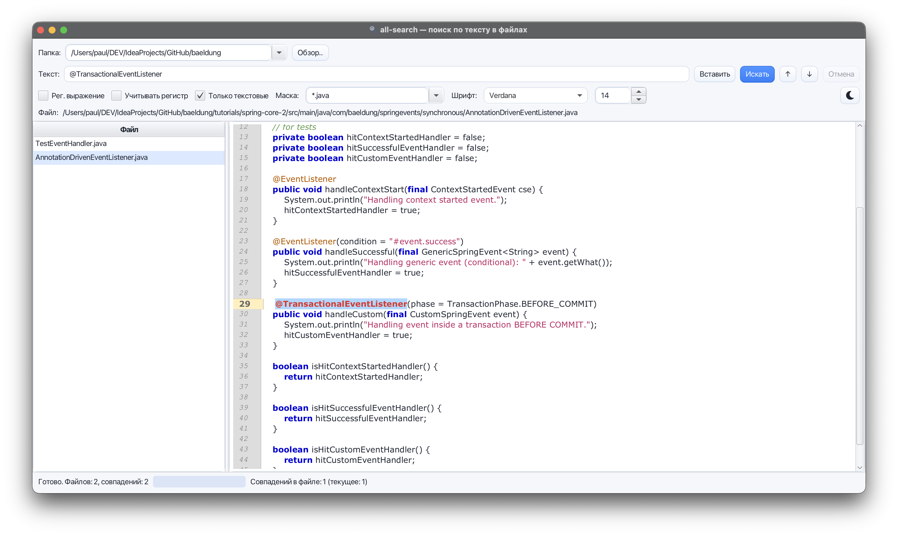
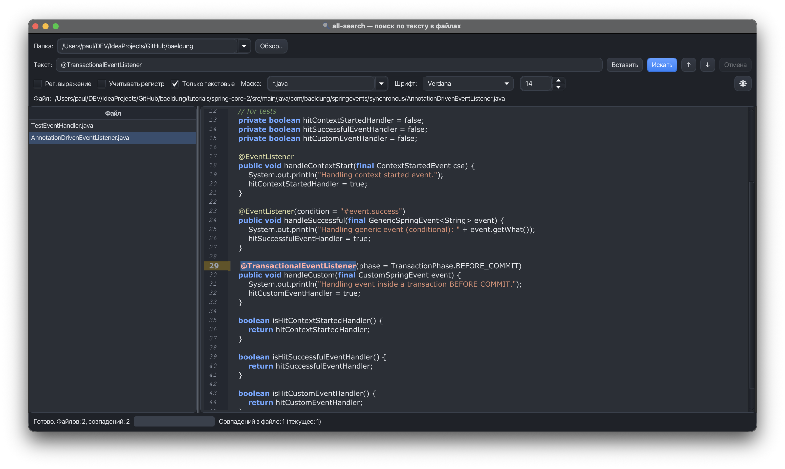

# all-search

Десктоп-приложение на JavaFX для полнотекстового поиска по файлам.
Аналог AVSearch (Windows)

Навайбкодил за вечер тестируя разные LLM




## Требования

- JDK 25
- `JAVA_HOME` должен указывать на JDK 25
- Maven 4 (Maven Wrapper уже настроен на Maven 4)

Сборка нативных дистрибутивов выполняется на целевой ОС: `jpackage` не умеет
собирать пакеты для Windows или Linux из macOS. Собирать нужно на той платформе,
для которой создаётся дистрибутив.

## Запуск приложения

```bash
./mvnw clean javafx:run
```

## Тесты

```bash
./mvnw clean test
```

Запуск одного тест-класса:

```bash
./mvnw -Dtest=SearchEngineTest test
```

## Сборка дистрибутивов

Дистрибутивы собираются с помощью `jpackage-maven-plugin` по той же схеме, что и
в проекте-примере: `maven-shade-plugin` готовит исполняемый fat-jar, а
`jpackage-maven-plugin` создаёт jlink-образ и нативный пакет.

Общий результат сборки:

- `target/input/all-search-1.0-SNAPSHOT.jar` — исполняемый fat-jar
- `target/javafx-modules/` — модули JavaFX для `jlink`
- `target/distributions/` — готовый дистрибутив

### macOS (DMG)

Профиль `mac` включён автоматически на macOS:

```bash
./mvnw clean package
```

Результат: `target/distributions/all-search-1.0.0.dmg`

### Windows (установщик EXE)

Установщик `.exe` с ярлыком и пунктом меню «Пуск». Требует установленного
WiX Toolset:

```bat
mvnw.cmd clean package -Pwindows
```

### Windows (portable)

Portable app-image без установки и записи в реестр, WiX не требуется:

```bat
mvnw.cmd clean package -Pwindows-portable
```

Результат: `target\distributions\all-search\all-search.exe`

Для portable-версии нужно переносить всю папку `target\distributions\all-search`,
а не только файл `.exe` — рядом находятся runtime Java и библиотеки приложения.

### Linux (DEB)

Для команды «Открыть с помощью…» нужен `gio` (в Debian/Ubuntu пакет
`libglib2.0-bin`). Он запускает приложения по их `.desktop`-описаниям.

Профиль `linux` включён автоматически на Linux:

```bash
./mvnw clean package
```

Результат: `target/distributions/all-search_1.0.0_amd64.deb`

### Иконки

- macOS: `src/main/resources/ru/sarteam/allsearch/icons/all-search.icns`
- Windows: `src/main/resources/ru/sarteam/allsearch/icons/all-search.ico`
- Linux: `src/main/resources/ru/sarteam/allsearch/icons/all-search.png`
